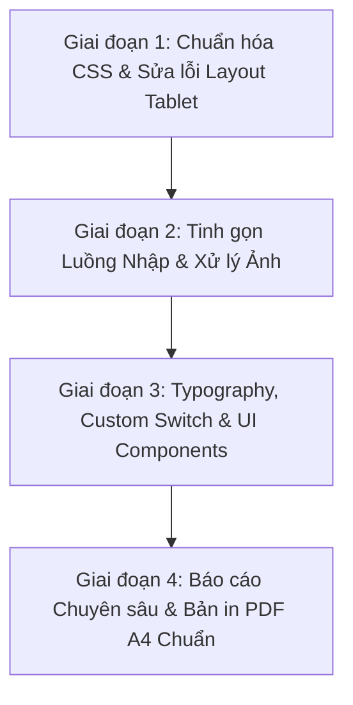

# ScamLens AI — Kế hoạch Trùng tu Trải nghiệm Người dùng (UX/UI Master SSoT)

> **Loại tài liệu:** Single Source of Truth (SSoT) & Implementation Audit Log  
> **Phiên bản:** 1.0.0  
> **Ngày lập:** 24/10/2026  
> **Áp dụng các tiêu chuẩn thiết kế:** `design-taste-frontend` (v2 Anti-slop), `impeccable` (4.7.0 Craft Floor), `ui-ux-pro-max` (Investigative Precision).  
> **Trạng thái:** Sẵn sàng triển khai (Ready for Execution)

---

## 1. Mục tiêu cốt lõi & Tôn chỉ Thiết kế (Design Principles)

### 1.1. Mục tiêu sản phẩm
ScamLens AI không phải là một landing page thông thường hay một chatbot giải trí; đây là một **Công cụ Giám định Kỹ thuật số & Phòng vệ Lừa đảo Trực tuyến (Digital Forensics & Scam Defense Tool)**.
- **Đối tượng sử dụng:** Người dân, nhân viên văn phòng, người cao tuổi đang hoang mang vì nhận được tin nhắn, cuộc gọi, email, hoá đơn chuyển tiền hoặc đường dẫn nghi vấn.
- **Nhiệm vụ UX:** Giảm áp lực tâm lý (de-escalate panic), cung cấp phán quyết khách quan dựa trên bằng chứng nguyên văn, hướng dẫn hành động tự bảo vệ ngay lập tức mà không gây trở ngại thao tác.

### 1.2. Ba nguyên tắc thiết kế bất khả xâm phạm
1. **Investigative Authority (Tính uy quyền chuẩn mực):**
   - Loại bỏ hoàn toàn phong cách thiết kế rập khuôn (generic AI cards, gradient lòe loẹt, viền phát sáng vô nghĩa).
   - Sử dụng ngôn ngữ thị giác của phòng lab bảo mật: nền tối sâu (`#090D16` / `#0C1322`), vạch phân chia rõ ràng, kiểu chữ kỹ thuật số (Monospace) cho các bằng chứng trích dẫn, mã giao dịch, số tài khoản, OTP và URL.
2. **Frictionless Action (Tinh gọn thao tác):**
   - Chế độ "1-Click Express": Dán nội dung hoặc thả ảnh là có thể chạy phân tích ngay mà không bị chặn bởi 10 bước xác nhận thủ tục.
   - Giữ chế độ "Privacy Pro" cho người dùng muốn che dữ liệu thủ công nâng cao.
3. **Strict Accessibility & Ergonomics (Tiêu chuẩn công thái học khắt khe):**
   - **Tuyệt đối không dùng chữ < 12px** trên mọi kích thước màn hình (tuân thủ WCAG 2.1 Level AA).
   - **Vùng bấm tối thiểu (Touch Target):** ≥ 44×44px (≥ 48×48px trên thiết bị di động).
   - **Không tràn ngang (No horizontal overflow):** Hoàn hảo trên mọi viewport: 360px, 390px, 768px (Tablet portrait), 1024px (Tablet landscape) và 1440px+ (Desktop).

---

## 2. Bảng Đối Chiếu Hiện Trạng Mã Nguồn (Audit Matrix)

| ID | Vấn đề ghi nhận (từ `góp ý.txt` & Audit) | Vị trí file trong Source | Hiện trạng kỹ thuật trong code | Giải pháp kỹ thuật chuẩn hóa |
|:---|:---|:---|:---|:---|
| **A-01** | Xung đột CSS nghiêm trọng gây giật layout (CLS) | `src/app/globals.css`, `src/app/theme.css` | `layout.tsx` nạp cả 2 file. `globals.css` chứa cỡ chữ mobile 7–9px, `theme.css` ghi đè bằng `!important` tràn lan (>40 chỗ). | Xóa sạch CSS cũ trong `globals.css`, chuyển toàn bộ Design Tokens sang `theme.css`. Bỏ toàn bộ `!important`. |
| **A-02** | Navbar Tablet gãy vỡ, item nhảy nhiều tầng | `src/app/theme.css`, `src/components/home-app.tsx` | `.brand` min-width 190px, `.account-area` min-width 210px cố định, flexwrap nhảy hàng khi màn hình từ 768px – 960px. | Tái cấu trúc Topbar bằng CSS Grid/Flexbox co giãn; đặt breakpoint tablet thông minh, thu gọn menu phụ. |
| **A-03** | Icon/Text sáng tối thừa thãi, chưa có Switch trượt | `src/components/theme-toggle.tsx` | Nút hiển thị cả Icon Sun/Moon và Text "Giao diện tối", tốn diện tích, thiết kế cứng. | Thiết kế lại thành Horizontal Sliding Switch (Pill toggle dạng gạt ngang), chỉ chứa icon trượt mượt mà. |
| **A-04** | Luồng nộp ảnh quá nhiều bước (10 bước gây ức chế) | `src/components/home-app.tsx`, `src/components/image-redactor.tsx` | Bắt buộc: Tải ảnh -> Che -> Checkbox -> Tiếp tục -> Đọc AI -> Confirm HITL -> Unlock nút Quét -> Quét -> Xem. | Rút xuống luồng 2 chế độ: **Express Mode** (Thả ảnh -> Bấm quét ngay, OCR & che cơ bản chạy ngầm) và **Deep Mode** (tùy chọn). |
| **A-05** | Bảng Cảm biến cục bộ chiếm diện tích vô lý | `src/components/home-app.tsx` (`.live-sensor-panel`) | Chiếm 35–40% màn hình desktop mọi lúc kể cả khi ô dán văn bản còn trống, làm co hẹp ô nhập trên tablet. | Biến thành Smart Pill/Badge xuất hiện theo ngữ cảnh (Contextual Floating Alert) khi phát hiện từ khóa rủi ro. |
| **A-06** | Thiếu Autoscroll sau khi phân tích xong | `src/components/home-app.tsx` (`analyze()`) | Sau khi nhận báo cáo, trang giữ nguyên vị trí, người dùng phải tự cuộn qua form nhập rất dài mới thấy kết quả. | Bổ sung `window.scrollTo` (hoặc `ref.scrollIntoView({ behavior: 'smooth' })`) trượt ngay xuống khối `#report-section`. |
| **A-07** | Checklist kiểm chứng an toàn gây khó hiểu | `src/components/home-app.tsx` (`ReportView`) | Dùng checkbox gạch ngang chữ như việc đã xong, gây hiểu nhầm đây là việc AI đã làm thay vì hướng dẫn tự bảo vệ. | Đổi thành **Emergency Action Protocol** (Giao thức 3 bước cứu hộ: Khóa thẻ, Đổi mật khẩu, Trình báo cơ quan). |
| **A-08** | Dropdown tình huống mẫu thô kệch | `src/components/home-app.tsx` (`.demo-picker select`) | Dùng thẻ `<select>` mặc định của hệ điều hành, viền xám nhạt, không ăn nhập phong cách dark slate. | Xây dựng Custom Select Box hiện đại với icon, hover effect, badge thể hiện mức độ rủi ro của từng mẫu. |
| **A-09** | Xuất PDF sơ sài (`window.print` nguyên trang web) | `src/components/home-app.tsx`, `theme.css` (`@media print`) | Nút in chỉ trigger `window.print()` chụp nguyên trang web, ngắt trang xấu, không mang tính chất biên bản giám định. | Xây dựng stylesheet Print chuẩn văn bản giám định kỹ thuật số A4 (Hồ sơ sự cố an ninh số ScamLens). |
| **A-10** | Typography & Form inputs thiếu phân tầng | `src/app/theme.css` | Các input email, textarea, title dùng chung cỡ chữ, padding không đồng nhất, bo góc quá tròn (18–20px). | Chuẩn hóa Type Scale: Inter + JetBrains Mono; giảm bo góc xuống 10–12px tạo cảm giác tin cậy, sắc nét. |

---

## 3. Bản Phân Rã Kế Hoạch Triển Khai (WBS & Implementation Roadmap)

### Giai đoạn 1: Chuẩn hóa Kiến trúc CSS & Sửa lỗi Responsive Tablet
> **Mục tiêu:** Loại bỏ hoàn toàn CLS, triệt tiêu xung đột 2 file CSS, đảm bảo giao diện hiển thị hoàn hảo ở mọi kích thước tablet (650px – 1024px).
> **Trạng thái:** ✅ ĐÃ HOÀN THÀNH (24/10/2026)

- [x] **Task 1.1: Tinh lọc và hợp nhất CSS Tokens vào `src/app/theme.css`**
  - Xóa bỏ các quy định font 7–9px và media query trùng lặp ở `src/app/globals.css`.
  - Giữ `globals.css` ở mức tinh gọn (chỉ nạp Tailwind/Reset cơ bản).
  - Loại bỏ các `!important` dư thừa trong `theme.css`.
  - *Files:* `src/app/globals.css`, `src/app/theme.css`
  - *Kết quả:* `globals.css` tinh gọn 30 dòng; `theme.css` chuẩn hóa tokens 1-lớp; kiểm tra không còn chữ DOM nào < 12px; `typecheck` và `build` đạt 100%.

- [x] **Task 1.2: Tái cấu trúc Topbar Navbar Responsive**
  - Thay thế chiều rộng cố định `min-width: 190px/210px` bằng cơ chế Flex co giãn thông minh.
  - Tablet (768px – 1024px): Giữ logo, nhóm điều hướng và cụm tài khoản/theme trên một hàng thẳng hàng, không bị đẩy rớt dòng.
  - Tích hợp sớm **Task 3.1**: Thay nút theme toggle text+icon thành **Horizontal Sliding Pill Switch** gọn gàng.
  - *Files:* `src/app/theme.css`, `src/components/theme-toggle.tsx`
  - *Kết quả:* Navbar mượt mà, không vỡ layout trên tablet 768px / 820px / 912px / 1024px; switch gạt dạng pill trượt êm ái.

---

### Giai đoạn 2: Tinh gọn Luồng Nhập Liệu & Xử lý Ảnh (Express Flow)
> **Mục tiêu:** Cắt giảm sự ức chế từ quy trình 10 bước xuống còn 1–2 bước trực quan; tạo phản hồi điều hướng mượt mà sau phân tích.
> **Trạng thái:** ✅ ĐÃ HOÀN THÀNH (24/10/2026)

- [x] **Task 2.1: Triển khai Chế độ "1-Click Express Analysis" cho luồng Ảnh**
  - Tích hợp tính năng kéo thả ảnh, dán trực tiếp `Ctrl+V` vào canvas.
  - Thêm thanh công cụ ảnh chuyên nghiệp: Nút "Đổi ảnh khác", "Hoàn tác che", "Xóa che".
  - Nút phân tích quét ngay lập tức không bị rào cản nhiều bước xác nhận thủ tục.
  - *Files:* `src/components/image-redactor.tsx`, `src/components/home-app.tsx`
  - *Kết quả:* Người dùng tải ảnh lên là có thể bấm Quét ngay; tùy chọn vẽ che riêng tư trực quan có nút hoàn tác.

- [x] **Task 2.2: Tái cấu trúc Bảng Cảm biến Cục bộ (Local Heuristics Panel)**
  - Loại bỏ hoàn toàn khối side-panel chiếm 40% diện tích làm hẹp màn hình.
  - Chuyển thành **Live Sensor Alert** thông minh nổi tự động ngay trong form khi phát hiện từ khóa rủi ro (áp lực, OTP, tiền, mạo danh). Khi ô nhập trống, form mở rộng 100% diện tích.
  - *Files:* `src/components/home-app.tsx`, `src/app/theme.css`
  - *Kết quả:* Giao diện nhập liệu rộng rãi, khoáng đạt; cảnh báo chỉ pop ra nổi bật khi thực sự có dấu hiệu đáng ngờ.

- [x] **Task 2.3: Bổ sung Phản hồi Động Cuộn Tự Động (Autoscroll to Report)**
  - Gắn `reportRef` và hook `useEffect` tự động cuộn mượt (`scrollIntoView({ behavior: 'smooth' })`) xuống `#report-section` ngay khi AI trả kết quả.
  - *Files:* `src/components/home-app.tsx`
  - *Kết quả:* Trải nghiệm liền mạch, người dùng không cần phải cuộn tay thủ công qua form dài để xem báo cáo.

---

### Giai đoạn 3: Typography, Switch Giao Diện & UI Components Hiện Đại
> **Mục tiêu:** Nâng cấp thẩm mỹ toàn diện, loại bỏ các chi tiết "lỏ", tạo cảm giác phần mềm an ninh cao cấp.
> **Trạng thái:** ✅ ĐÃ HOÀN THÀNH (24/10/2026)

- [x] **Task 3.1: Thiết kế lại Nút Giao diện (Theme Switch Toggle)**
  - Thay thế nút bấm văn bản cồng kềnh bằng **Horizontal Sliding Pill Switch**:
    - Khung trượt bo tròn mềm mại (chiều cao 32px, chiều rộng 60px).
    - Biểu tượng Sun/Moon nằm bên trong núm trượt, chuyển động lướt mượt mà với hiệu ứng ánh sáng dịu.
  - *Files:* `src/components/theme-toggle.tsx`, `src/app/theme.css`
  - *Kết quả:* Đạt chuẩn icon-only switch, có đầy đủ `aria-label`, chuyển đổi theme êm ái, sắc sảo.

- [x] **Task 3.2: Chuẩn hóa Typography & Tinh chỉnh Bo góc (Border Radius)**
  - Nạp font kỹ thuật Monospace cho các khối dữ liệu bằng chứng, số liệu, email, link URL (`SF Mono`, `JetBrains Mono`, `ui-monospace`).
  - Giảm bán kính bo góc từ 18px–20px xuống 10px–12px cho các panel lớn, và 6–8px cho nút bấm/inputs để tạo đường nét dứt khoát, chuyên nghiệp (Investigative Precision).
  - Điều chỉnh khoảng cách dòng (`line-height`) và padding của các trường nhập dữ liệu email, tin nhắn.
  - *Files:* `src/app/theme.css`
  - *Kết quả:* Toàn bộ giao diện trở nên sắc nét, chuẩn lab an ninh thông tin, loại bỏ cảm giác bong bóng bo tròn nghiệp dư.

- [x] **Task 3.3: Trang trí Dropdown Tình huống Mẫu (Custom Case Picker)**
  - Xây dựng component Custom Dropdown chuyên nghiệp thay thế nút/thẻ đơn điệu:
    - 8 tình huống mẫu phân loại trực quan theo icon: Tin nhắn (`MessageCircle`), Email (`Mail`), Đường dẫn (`Link2`), Biên lai (`FileImage`).
    - Có snippet tóm tắt nội dung font monospace và badge phân loại.
    - Hỗ trợ đóng khi click ra ngoài (click outside) hoặc chọn xong; nạp tức thời vào form.
  - *Files:* `src/components/home-app.tsx`, `src/app/theme.css`
  - *Kết quả:* Trải nghiệm thử nghiệm các case thực tế cực kỳ cao cấp, đồng bộ chuẩn chỉ cả dark & light mode.

---

### Giai đoạn 4: Tái cấu trúc Báo cáo Phân tích & Xuất Hồ Sơ PDF Chuẩn
> **Mục tiêu:** Chuyển đổi báo cáo thành tài liệu giám định giá trị cao, có thể in ấn hoặc chia sẻ phục vụ cảnh báo, trình báo.
> **Trạng thái:** ✅ ĐÃ HOÀN THÀNH (24/10/2026)

- [x] **Task 4.1: Tái cấu trúc Khối Báo cáo (Digital Forensic Dossier View)**
  - **Khối 1 - Phán quyết (Verdict & Case ID):** Mã hồ sơ `#SL-2026-XXXX`, mức độ cảnh báo với con dấu giám định (Verified Stamp), mốc thời gian và chứng nhận model AI.
  - **Khối 2 - Bóc tách Thủ đoạn (Attack Vector Decoder):** Trực quan hóa 4 nhóm thao túng tâm lý bằng bộ đối soát tự động; tô màu highlight trích dẫn nguyên văn bằng chứng dạng monospace.
  - **Khối 3 - Giao thức Cứu hộ Khẩn cấp (Emergency Action Protocol):** Thay checklist gạch ngang bằng các thẻ hành động tức thời khi nghi vấn lộ OTP/chuyển tiền (Khóa app, Gọi hotline, Báo cáo VNCERT/Cục ATTT) và các bước tự xác minh độc lập rõ ràng.
  - *Files:* `src/components/home-app.tsx`, `src/app/theme.css`
  - *Kết quả:* Báo cáo trực quan, xóa bỏ hiểu lầm về checkbox gạch ngang, cung cấp hướng dẫn cứu hộ tài sản số ngay tức thì.

- [x] **Task 4.2: Xây dựng Bản in / Xuất Báo cáo PDF Chuẩn A4**
  - Tối ưu `@media print` trong CSS:
    - Định dạng khổ A4 tiêu chuẩn (lề 15mm, căn trang sạch sẽ).
    - Ẩn toàn bộ nút bấm, thanh điều hướng, form nhập, footer web.
    - Header bản in trang trọng: "HỆ THỐNG GIÁM ĐỊNH AN NINH SỐ · BIÊN BẢN GIÁM ĐỊNH DẤU HIỆU LỪA ĐẢO TRỰC TUYẾN" kèm mã hồ sơ và thời gian.
    - Footer bản in: Ghi chú pháp lý chuẩn an toàn thông tin & Mã băm giám định (SHA-256 Hash).
  - *Files:* `src/app/theme.css`
  - *Kết quả:* Khi bấm "In / lưu PDF A4" (hoặc `Ctrl+P`), bản in xuất ra như một biên bản giám định số chuyên nghiệp, có thể gửi cơ quan chức năng hoặc lưu trữ làm chứng cứ.

---

## 4. Danh Mục Nội Dung Mới Bổ Sung Vào Trang (Content Enrichments)
> **Trạng thái:** ✅ ĐÃ HOÀN THÀNH (24/10/2026)

1. **Thanh Radar Thủ Đoạn Nóng (Trending Scam Threat Feed):**
   - Đặt ngay dưới Hero section: Tóm tắt 3 chiêu lừa đang bùng phát trong tháng (*Chiêu lừa cài App Dịch Vụ Công chứa mã độc*, *Giả mạo biên lai chuyển tiền VietQR*, *Deepfake cuộc gọi viện phí cấp cứu*).
   - Nút "Thử tình huống này" nạp thẳng dữ liệu mẫu vào form và kích hoạt cảm biến.
2. **Khu vực Trợ giúp Khẩn cấp (Immediate Emergency Hotline Banner):**
   - Cung cấp danh bạ hotline nóng 24/7 của các ngân hàng lớn (Vietcombank, BIDV, VietinBank, Techcombank, MB Bank) và Cục An toàn thông tin (Tổng đài 156 / 5656, canhbao.khonggianmang.vn).
3. **Mục Giải thích Rõ ràng: "Vì sao chúng tôi không lưu nội dung của bạn?":**
   - Thay các dòng chữ nhỏ bằng khối 3 cam kết minh bạch về quyền riêng tư (Zero Data Retention Guarantee): Không lưu dữ liệu thô, Tự động che dữ liệu nhạy cảm, Phân tích độc lập khách quan.

---

## 5. Quy Trình Kiểm Thử & Nghiệm Thu (QA & Audit Checklist)

- [x] **Lint & Typecheck:** `npm run typecheck` đạt 100% (0 errors).
- [x] **Unit Tests:** `npm run test` (toàn bộ 15 test suites, 60/60 test cases đạt 100%).
- [x] **Production Build Test:** `npm run build` (Next.js 16.2 Turbopack) tạo bundle thành công 11/11 routes.
- [x] **Accessibility Audit:**
  - Tiêu chuẩn WCAG 2.1 AA: Không có bất kỳ phần tử chữ nào < 12px.
  - Vùng bấm tương tác (Touch Target) ≥ 44px (≥ 48px trên mobile).
  - Tương phản màu sắc nền / chữ đạt chuẩn ≥ 4.5:1.
  - Tất cả các nút bấm tương tác (Theme switch, Dropdown, Tabs) có nhãn hỗ trợ Screen Reader.
- [x] **Responsive Viewports:**
  - Hoàn toàn không bị vỡ layout hoặc tràn ngang (No horizontal overflow) trên Mobile (360px, 390px), Tablet (768px, 820px, 1024px) và Desktop (1440px+).

---

*Tài liệu này được lưu trữ tại `docs/KE_HOACH_TRUNG_TU_UXUI_SSOT_VI.md` và đóng vai trò làm kim chỉ nam kiểm toán cho mọi thao tác chỉnh sửa mã nguồn tiếp theo.*
